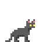

# Other Projects

Completed and in-progress projects whose repositories are private. Each entry
says what the project is, how it is built, and where it stands. Short
representative excerpts are in [code_samples/](code_samples/).

---

## Bakau: image fingerprinting and provenance

Infrastructure for finding every copy of an image, recording who made what, and
making rights legible to software and buyers. It produces evidence, never a
ruling on ownership. Images are fingerprinted in memory and discarded; none is
stored. Live at [bakau.org](https://bakau.org).

- **Matching engine** (Python, on the device): exact files (ISCC), resized and re-encoded copies (pHash, centre square, private region signatures), and crops, rotations and mirrors (SSCD proposes, RootSIFT + RANSAC + tile overlap confirms). It finds copies, not look-alikes.
- **Measured, not claimed.** A committed benchmark scores 200 originals × 19 edits for recall and checks 3.2 million pairs against an 800-image held-out set: zero false matches.
- **Archive audits** for catalogue owners preparing for licensing: one CLI command turns a folder of images into an HTML, CSV and JSON report.
- **Claims, not content.** The registry stores a fingerprint, the claimant's statement and terms, and a trusted timestamp, never the work. It is currently frozen and off the public site.
- **Cheap to run.** One Fly app deployed from GitHub releases on a Neon Postgres database; both sleep when idle, so it costs cents a month.

**Stack:** Python · FastAPI · PostgreSQL · Docker · Fly.io · Neon.

Built and run by one person. Source-available under PolyForm Noncommercial.

---

## Parasite: 2D platformer (Unity)

A solo 2D action-platformer in Unity and C#. The player moves through an
interactive, nature-themed world that blends exploration, questing and story.

- **Event-driven systems.** Gameplay communicates through ScriptableObject event channels rather than direct references, so combat, questing and world state react to each other without hard dependencies ([sample](code_samples/Parasite.cs)).
- **Narrow responsibilities.** Movement, combat, dialogue and quest tracking each sit behind a small interface; ScriptableObjects keep data apart from behaviour, so content is authored without touching code.
- **Responsive control and combat.** Frame-tuned 2D movement with real-time minigames and a state-driven combat system.
- **Data-driven progression.** Quest objectives are defined as data, easy to extend.

Built end to end by one developer: systems design, gameplay programming and content. In active development.

---

## Sérain: product website

A brand and product site for Sérain, a line of botanical tisanes, each
"expression" themed around a place in the world. Live at
[serain.us](https://serain.us) on Netlify, with Cloudflare DNS.

- **Interactive 3D bottle.** One glTF model rendered with Three.js; a single offscreen renderer is reused across slides and blitted to per-slide canvases. The liquid is recoloured per expression, and printed labels are applied as textures.
- **Editorial scroll.** Opens on an Old French dictionary entry for *sérain* ("rain falling from a cloudless sky"), then snaps into a horizontal carousel of product expressions with tasting notes and ingredients ([sample](code_samples/serain.html)).
- **Input handling.** Trackpad, mouse and touch swipe, with seamless clone-based looping and wheel smoothing that detects the leading edge of a gesture.
- **Selling without redeploys.** Price tags and next-sale details are read from a Google Sheet at load time, so availability changes without touching the site.
- **Mailing list and feedback.** A sign-up modal and per-product feedback through Netlify Forms and Formspree, with honeypot spam protection and per-product cooldowns.
- **Print-accurate labels.** A companion tool renders true-size labels (2.125″ × 4.25″ with safe-margin guides), and a label preview page shows a design on the 3D bottle before printing.

**Stack:** vanilla HTML/CSS/JS · Three.js · Netlify (hosting, Forms) · Cloudflare (DNS) · Formspree · Google Sheets.

---

*Maintained by [@jmsherrier](https://github.com/jmsherrier).*
